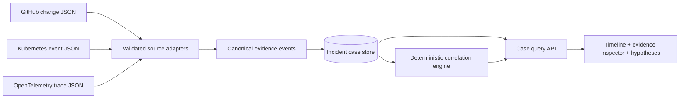

# Design: Incident Stitcher MVP

**Status:** Proposed architecture; no implementation exists yet.

## Architecture



## Canonical event contract

```ts
type SourceKind = "github" | "kubernetes" | "otel";
type EvidenceEvent = {
  id: string; // deterministic from import id + source record id
  caseId: string;
  source: SourceKind;
  sourceRecordId: string;
  service: string | null;
  occurredAt: string | null; // UTC ISO 8601, or null when invalid/missing
  originalTimestamp: string | null;
  kind: string;
  summary: string;
  metadata: Record<string, string | number | boolean | null>;
};
type Hypothesis = {
  id: string;
  caseId: string;
  title: string;
  explanation: string;
  ruleId: string;
  supportingEvidenceIds: string[];
  conflictingEvidenceIds: string[];
  status: "candidate";
};
```

Do not put raw sensitive trace attributes in generic metadata. Define a source-specific allowlist.

## Import and normalization

1. User selects bundled synthetic case or supplies a JSON export.
2. Adapter validates schema, enforces limits, and returns canonical events with warnings.
3. Normalizer produces UTC times and stable evidence IDs; unknown times remain null.
4. Server stores evidence and preserves original record identifiers for inspection.
5. UI renders the same persisted records for both timeline and hypothesis details.

## Correlation strategy: deterministic first

Start with an explicit rule, such as: a deployment/change in service A is followed within a configurable time window by error-related Kubernetes events or trace failures involving service A. Match only when source timestamps and service mapping are valid. Output a **candidate** with references to each matched input and the rule configuration. Do not imply causation. Add a conflicting-evidence field when available.

## Proposed internal interfaces

- `parseGithubExport(input): ParseResult<EvidenceEvent>`
- `parseKubernetesExport(input): ParseResult<EvidenceEvent>`
- `parseOtelExport(input): ParseResult<EvidenceEvent>`
- `normalizeEvents(events): EvidenceEvent[]`
- `findHypotheses(events, rules): Hypothesis[]`
- `getCase(caseId): { events, hypotheses, warnings }`

Validate payloads at route boundaries. Keep parsers and correlations pure, side-effect-free, and unit-testable.

## UX

A single investigation page: source-summary cards, timeline with source/service filters, and a hypothesis panel showing exact evidence. Include loading, empty, invalid-import, and insufficient-evidence states. Display a clear "Synthetic demo data" label on all sample-derived views.

## Quality and threat model

- Strict file type, byte-size, and record-count limits; sanitized rendered strings.
- Timezone and out-of-order-event tests.
- Deterministic output from identical fixtures; stable evidence IDs.
- Prevent client-side secrets and arbitrary shell or remote execution.
- Explicitly separate observed evidence from inferred explanations.
- Public demo must be usable without a private GitHub token or cluster access.

## Deployment decision

Use a deployment-friendly storage mode that supports demo reliability. In-memory data may be acceptable for the synthetic read-only demonstration; persistence is optional until its value is justified. Confirm during implementation.

## Note on Kiro

These design artifacts were prepared in the repo as a starting point. They are **not** proof that the app was built using Kiro. Use Kiro to inspect, revise, implement, test, and document the actual work.
