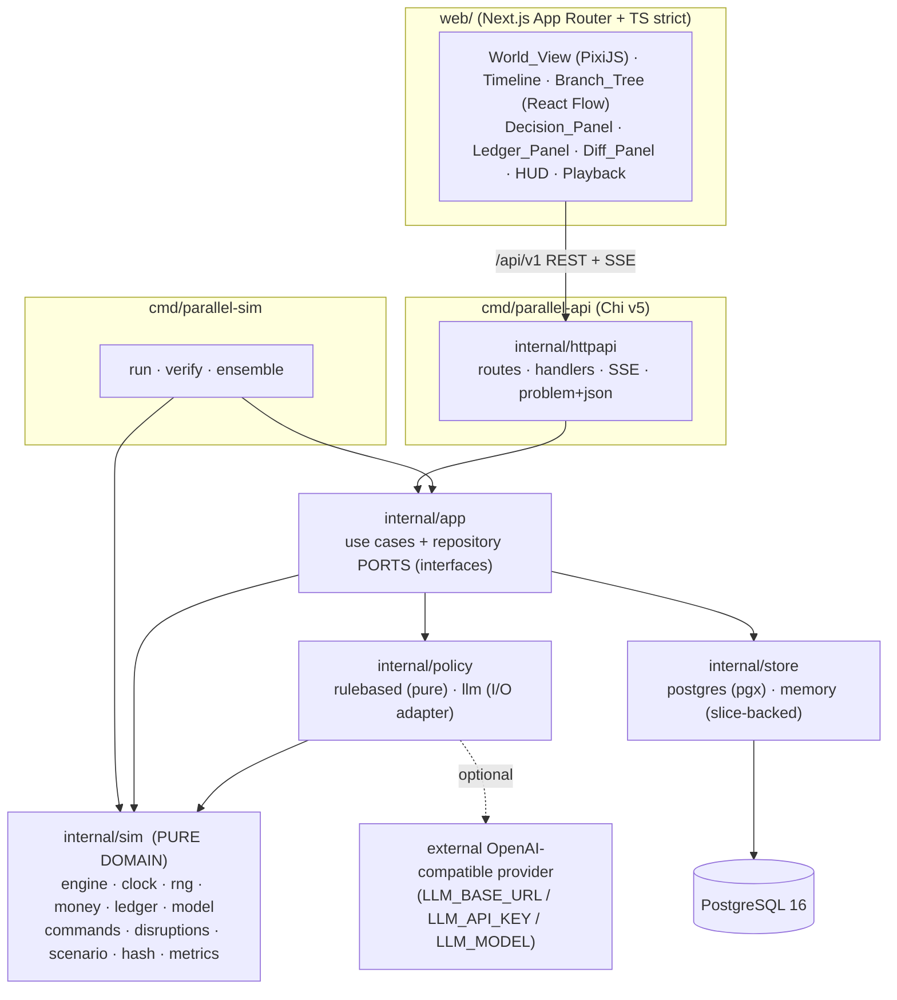

# Design Document

## Overview

Parallel is a deterministic, forkable simulation of a single-warehouse e-commerce business under crisis, delivered as a modular monolith. This design turns the approved `requirements.md` (37 MVP requirements, 1 polish requirement, 5 stretch requirements) and the steering set (`product.md`, `tech.md`, `structure.md`, `simulation-invariants.md`, `security.md`, `ui-design-system.md`, `hackathon.md`) into a concrete, buildable architecture.

The load-bearing idea is a pure simulation core. Everything a user sees — state, ledger, metrics, hashes — is **derived** by replaying an **immutable input log** (seed, scenario, commands, disruptions) through a deterministic engine. Rewind is a read. Changing the past is a fork. A duel is two sibling branches advanced in lockstep under identical exogenous conditions. These follow directly from the product principles and the invariants `INV-1`…`INV-19`.

Design values, in priority order, match the steering: **determinism and correctness first**, then **a working vertical slice end to end**, then breadth. The plan is dependency-ordered so the team can stop at any tier boundary with a working product, inside a 4000 Kiro-credit budget (500 reserved).

### Guiding decisions carried from requirements and steering

- **No floating point in `internal/sim` state transitions.** Money is `int64` cents, rates are `int64` basis points, one shared half-to-even rounding helper (Req 6, 10.16, 37; `tech.md` determinism rules).
- **Hybrid discrete-event time.** An event queue on an integer sim-minute clock; hourly tick boundaries are the only observation/hash/snapshot/metric/decision points (Req 5).
- **Input log is the record; state is derived.** Snapshots and projections are caches, trusted only when their stored hash equals the replayed hash (Req 13, 14, 28; `simulation-invariants.md`).
- **Independent named random streams, common random numbers.** Exogenous streams consume a fixed number of draws per tick regardless of commands (Req 7.2, 18.5).
- **Manager-blind engine.** The engine never reads manager kind or provenance; those are input metadata excluded from the hash (Req 12, 36.8, `INV-15`, `INV-18`).
- **LLM is optional and recorded.** Replay never calls the LLM; without an API key everything except the LLM opponent works (Req 19, 20, `INV-13`).

## Architecture

### Topology

One Go module (`github.com/savisaluwadana/KiroFrankenstein/backend`) producing two binaries, plus one Next.js app.



### Dependency direction (points inward)

- `internal/sim` imports only an allowlist of Go standard-library packages. It is enforced by an architecture test (see Testing Strategy). It exposes pure functions; it has no I/O, no `time.Now`, no `math/rand`, no `os`/`net`, no goroutines.
- `internal/policy/rulebased` imports only `internal/sim` types (`Observation`, `Command`).
- `internal/policy/llm` imports `internal/sim` types and an `http.Client`. It returns proposals; it never mutates state.
- `internal/app` imports `internal/sim`, the policy interfaces, and repository **ports it defines itself**.
- `internal/store/{postgres,memory}` and `internal/httpapi` import `internal/app`. Neither is imported by `internal/sim`.
- `web/` talks to the backend only through `/api/v1`; it never computes simulation results. It may interpolate positions between two authoritative ticks for display only.

### Why a modular monolith

The product is a single demo deployment with one database and optional server-side LLM key (`security.md` threat model). Microservices, Kafka, Kubernetes and vector databases are explicitly out of scope (`product.md`). Package boundaries, not network boundaries, give us the separation we need, and the architecture import test keeps the core pure.

## Components and Interfaces

Concrete Go signatures for the core domain. These are the contract the rest of the system builds on; exact field lists are refined during implementation but the shapes are fixed here.

### `internal/sim` — pure core

```go
package sim

// ---- Time ----
type SimMinute int64 // minutes since scenario start
type Tick int32      // one simulated hour; Tick 0 is the initial state

func (t Tick) Boundary() SimMinute { return SimMinute(t) * 60 }

// ---- Money and rates (no floats, ever) ----
type Cents int64 // signed minor units
type Bps   int64 // basis points (1% == 100 bps)

// RoundHalfEven is the ONLY integer-division rounding helper (Req 10.16).
// It computes round-half-to-even of num/den for den > 0.
func RoundHalfEven(num, den int64) int64

// MulDiv computes a*b/c exactly via 128-bit intermediates, half-to-even,
// without int64 overflow for values within assumption bounds (Req 37.9).
func MulDiv(a, b, c int64) int64

// ---- Randomness ----
type Seed uint64
type StreamName string // "demand", "supplier", "workforce", "disruption"

// Stream is a project-owned SplitMix64 PRNG derived from (seed, name).
type Stream struct{ state uint64 }
func NewStream(seed Seed, name StreamName) Stream
func (s *Stream) Next() uint64            // advances state
func (s *Stream) IntN(n uint64) uint64    // unbiased [0,n)
func (s Stream) Position() uint64         // for hashing/draw-count assertions

// ---- Events ----
type EventKind uint8
const (
  EvDemandArrivals EventKind = iota // generate potential arrivals + convert
  EvFulfilment                      // pick/pack ship
  EvLaborAccrual                    // wages
  EvMarketingAccrual
  EvOverheadAccrual
  EvOrderCancel
  EvPurchaseReceipt
  EvCommandApply                    // highest-priority at its sim-minute
  EvDisruptionOnset
  EvDisruptionEnd
)

type Event struct {
  At       SimMinute
  Priority uint8  // lower runs first at equal At; EvCommandApply == 0
  Seq      uint64 // monotonic insertion sequence, final tiebreak
  Kind     EventKind
  Payload  EventPayload // closed union, sealed in this package
}

// Event_Queue ordering key is (At, Priority, Seq). Req 5.3.
type EventQueue struct{ /* binary heap */ }
func (q *EventQueue) Push(Event)
func (q *EventQueue) Pop() (Event, bool)

// ---- State ----
// State is snapshot-complete: on its own (with the Scenario and the Inputs with
// later effective ticks) it is sufficient to continue deterministic execution
// (Req 14.6, 28.6, Glossary State). Every counter that affects later events and
// the full internal state of every Random_Stream are included.
type State struct {
  Clock       SimMinute
  Inventory   []SKUInventory   // sorted by SKU id; value==0 iff onHand==0
  Orders      OrderBook
  OrderSeq    uint64           // next order creation sequence counter
  PurchaseOs  []PurchaseOrder  // sorted by PO id
  POSeq       uint64           // next purchase-order identifier counter
  Workforce   Workforce        // incl. temp cohorts still in onboarding
  Ledger      Ledger
  Disruptions []ActiveDisruption // active disruptions, sorted (onset, input seq)
  Prices      []SKUPrice       // current price + marketing spend, sorted by SKU id
  Streams     []StreamState    // full SplitMix64 state per named stream, sorted by name
  Pending     []Event          // pending Event_Queue entries, canonical (At,Priority,Seq) order
  EventSeq    uint64           // Event_Queue insertion sequence counter
}

// StreamState carries the complete internal state of one Random_Stream so a
// resumed Snapshot reproduces every later draw exactly (Req 14.6, 28.6).
type StreamState struct { Name StreamName; State uint64 }

// ---- Engine: pure step functions ----
type Scenario struct { /* horizon, SKUs, suppliers, workforce, assumptions, disruption script, cadence, budget, weights, tie tolerance */ }

// Init builds the Tick 0 state (opening ledger entry, scheduled recurring events).
func Init(sc Scenario, seed Seed) State

// StepTick advances exactly one tick, applying the given inputs whose effective
// tick equals the destination tick, and returns the new state plus the
// per-tick outcome journal and fulfilment constraint report.
func StepTick(sc Scenario, in State, inputs []Input) (out State, journal []Outcome, fcr FulfilmentConstraintReport)

// Hash returns the SHA-256 of the canonical encoding of state (Req 12).
func Hash(State) [32]byte

// Encode/Decode: canonical, fixed field order, sorted collections (Req 12.5).
func Encode(State) []byte
func Decode([]byte) (State, error)

// ---- Observation and commands ----
type Observation struct { /* inventory, orders, POs, workforce, active disruptions (onset <= tick only), metrics, history, assumptions; NO script future, NO future draws, NO seed (Req 18.6) */ }
func Observe(sc Scenario, s State, at Tick) Observation

type CommandKind uint8
const (
  CmdSetPrice CommandKind = iota
  CmdPlacePurchaseOrder
  CmdExpeditePurchaseOrder
  CmdScheduleOvertime
  CmdHireTempWorkers
  CmdSetMarketingSpend
)
type Command struct { Kind CommandKind; Params CommandParams }

type RejectCode string // machine-readable, e.g. "insufficient_cash", "budget_exhausted"
type Rejection struct { Code RejectCode; Message string }

// Validate is deterministic, never mutates the command (Req 17.5, 17.6).
func Validate(sc Scenario, obs Observation, c Command, remainingBudget int) (ok bool, r Rejection)

// ---- Metrics (pure calculator, one source of truth) ----
type Metrics struct {
  NetRevenue, VariableCost, Contribution, NetProfit, NetCashFlow Cents
  ServiceLevel, FillRate Bps
  BacklogOrders, BacklogUnits, LateBacklogOrders, LateBacklogUnits int64
}
func ComputeMetrics(s State, at Tick) Metrics
func EndOfHorizonStatement(sc Scenario, s State) EndOfHorizonStatement

// Score components held in hundredths of a point (0..10000); opponent-independent
// (Req 21.5, 21.12). Computed with MulDiv/RoundHalfEven only.
type Score struct {
  FinancialComponent, FulfilmentComponent, OnTimeComponent Bps // each 0..10000
  Composite int64 // hundredths of a point, 0..10000
}
func ComputeScore(sc Scenario, s State, at Tick) Score
```

`Input` is the engine-visible projection of a recorded input (payload + effective tick + sequence), with **no** metadata (so the hash cannot depend on it):

```go
type Provenance string // "human","ai_rule_based","ai_llm","ai_rule_based_fallback"

type Input struct {
  EffectiveTick Tick
  Seq           uint64
  Kind          InputKind // command | disruption
  Command       *Command
  Disruption    *Disruption
}
```

### `internal/policy` — managers behind one interface

```go
package policy

type Manager interface {
  // Propose returns up to budget commands from the observation only.
  // It must be pure for rulebased; llm performs I/O but still returns proposals.
  Propose(obs sim.Observation, budget int) ([]Proposal, error)
}

type Proposal struct {
  Command   sim.Command
  Rationale string      // untrusted display text
  Provenance sim.Provenance
}
```

- `rulebased.Manager` is pure and deterministic (Req 19). Identical observation ⇒ identical proposals.
- `llm.Manager` wraps an `http.Client`, a base URL, model and key. On error/unparsable/timeout (20 s) it returns `(nil, err)`; `internal/app` then falls back to the rule-based manager and records provenance `ai_rule_based_fallback` with the reason (Req 20.3, 20.4).

### `internal/app` — use cases and ports

```go
package app

// Ports the app defines; implemented by store/postgres and store/memory.
type WorldRepo interface {
  CreateWorld(ctx, World) error
  GetWorld(ctx, WorldID) (World, error)
}
type InputRepo interface {
  AppendInput(ctx, BranchID, Input, Metadata) (InputRecord, error) // append-only
  InputsForBranch(ctx, BranchID, upTo sim.Tick) ([]sim.Input, []Metadata, error)
  FindByIdempotencyKey(ctx, BranchID, key string) (InputRecord, bool, error)
}
type SnapshotRepo interface {
  SaveSnapshot(ctx, BranchID, sim.Tick, hash [32]byte, blob []byte) error
  LoadLatestSnapshot(ctx, BranchID, atOrBefore sim.Tick) (Snapshot, bool, error)
}
type BranchRepo interface {
  CreateBranch(ctx, Branch) error
  ListBranches(ctx, WorldID) ([]Branch, error)
  SetHeadTick(ctx, BranchID, sim.Tick) error
}

type BranchService  struct{ /* WorldRepo, BranchRepo, InputRepo, SnapshotRepo, engine */ }
type DuelService    struct{ /* BranchService, policy.Manager factory */ }
type BranchDiffService struct{ /* BranchService */ }
```

`BranchService` owns advance, fork, rewind-read and replay, and is the one component that routes every command (human or AI) through `sim.Validate` before appending (Req 17.4, `INV-14`).

### `internal/httpapi` and `cmd/parallel-sim`

`httpapi` maps app results to JSON and `sim` typed errors to RFC 9457 `application/problem+json`. SSE lives here. `parallel-sim` wires `app` + `store/memory` (no DB, no network) for `run`, `verify`, `ensemble`.

## Data Models

### Scenario and assumptions

A Scenario is JSON (open question 1 resolved: JSON, strict stdlib decoder, no YAML dependency). Every Assumption carries `value, unit, default, min, max, rationale` (Req 1.7, 3.6). Monetary assumptions are integer cents, rate assumptions integer basis points (Req 1.6).

```jsonc
{
  "schemaVersion": 1,
  "name": "Black Friday Meltdown",
  "horizonTicks": 120,
  "startClock": "Thu 00:00",
  "decisionCadenceTicks": 4,
  "commandBudget": 5,
  "snapshotIntervalTicks": 24,
  "tieToleranceHundredths": 10,
  "scoreWeights": { "financialWeightBps": 5000, "fulfilmentWeightBps": 3000, "onTimeWeightBps": 2000 },
  "profitFloorCents": -5000000,
  "profitTargetCents": 20000000,
  "skus": [ { "id": "SKU1", "referencePriceCents": 2999, "openingUnits": 500, "openingUnitCostCents": 1500, "promiseTicks": 24 } ],
  "suppliers": [ { "skuId": "SKU1", "role": "primary", "unitCostCents": 1500, "leadTimeTicks": 12 },
                 { "skuId": "SKU1", "role": "backup",  "unitCostCents": 1900, "leadTimeTicks": 6 } ],
  "workforce": { "regularWorkers": 20, "unitsPerWorkerHour": 8, "maxOvertimePerWorker": 4,
                 "maxTempWorkers": 30, "tempOnboardingTicks": 6 },
  "wages": { "regularPerHourCents": 2200, "overtimePerHourCents": 3300, "tempPerHourCents": 2500 },
  "costs": { "outboundShipCentsPerUnit": 400, "expediteFeeCents": 5000, "expediteReductionTicks": 4,
             "hourlyOverheadCents": 120000, "serviceCreditPerLateOrderCents": 500 },
  "demand": { "hourlyProfile": [ /* 24 bps-of-base values */ ], "baseArrivalsPerTick": 60,
              "priceElasticityBps": 1500, "marketingEffectBps": 300, "cancelThresholdTicks": 48 },
  "assumptionMeta": { /* per field: unit, default, min, max, rationale */ },
  "disruptionScript": [
    { "kind": "demand_surge",    "onsetTick": 48, "durationTicks": 24, "magnitudeBps": 25000 },
    { "kind": "supplier_outage", "onsetTick": 60, "durationTicks": 18, "target": "primary" },
    { "kind": "workforce_absence","onsetTick": 54, "durationTicks": 12, "magnitudeBps": 3000 }
  ]
}
```

The Disruption_Script is **not** an Assumption and is excluded from the Observation beyond the current tick (Req 18.6, 31.3, 31.4).

### State collections (canonical order)

- `Inventory`: sorted by SKU id; each `{skuId, onHandUnits, inventoryValueCents}` with `value==0 ⟺ onHand==0` (Req 37.11).
- `OrderBook`: orders keyed by per-branch creation sequence; status `open|shipped|cancelled`; fields `skuId, qty, unitPriceCents, createdAt, promisedBy, shippedAt?`.
- `PurchaseOrders`: sorted by per-branch PO sequence (Req 8.5); `{id, skuId, supplierRole, qty, placedTick, dueTick, receivedTick?}`.
- `Workforce`: `{regularOnShift, overtimeHoursByTick, tempCohorts:[{units, availableFromTick}]}`; temp cohorts within onboarding are carried here so their wages accrue while they add zero capacity (Req 9.8, 37.14).
- `Streams`: one `StreamState{name, state}` per named stream, serialized in sorted name order, carrying the **full** SplitMix64 internal state (not a mere position) so a resumed snapshot reproduces every later draw (Req 14.6, 28.6).
- Counters: `OrderSeq`, `POSeq` and the Event_Queue `EventSeq` are part of the State and the hash, so a resumed snapshot numbers and orders later orders, purchase orders and events identically to an uninterrupted run (Req 14.6, 28.6).

### Ledger (fixed chart of accounts)

Exactly these accounts, integer cents, this business only (Req 10, 37.1; `tech.md` ledger scope): `Cash, Inventory, Opening_Equity, Revenue, Cost_Of_Goods_Sold, Labor_Expense, Freight_Expense, Marketing_Expense, Overhead_Expense, Service_Credit_Expense`.

```go
type Account uint8
type Line struct { Account Account; Amount Cents } // + debit, - credit (or explicit side)
type LedgerEntry struct {
  Tick Tick; At SimMinute; Desc string; Cause CauseRef; Lines []Line // >= 2 lines, balanced
}
type Ledger struct { Entries []LedgerEntry; Balances [NAccounts]Cents }
```

## Simulation Algorithms

All algorithms run as events inside `StepTick`. Recurring hourly processes are scheduled at fixed minute offsets within each tick, fixed per engine version and documented here (Req 5.5; open question 7 resolved below).

### Within-tick minute offsets (engine version 1)

For tick N covering minutes `[(N-1)·60, N·60)`:

| Offset (min into tick) | Priority | Event |
|---|---|---|
| 0 | 0 | `EvCommandApply` (all commands effective at N, in input sequence order) — Req 5.7 |
| 0 | 1 | `EvDisruptionEnd` (expiries at N) — Req 5.8 |
| 0 | 2 | `EvDisruptionOnset` (activations at N: Disruption_Script entries in script order, then injected Disruptions in ascending Input sequence) — Req 5.8 |
| 0 | 3 | `EvPurchaseReceipt` due at N |
| 5 | 4 | `EvDemandArrivals` (generate + convert) |
| 30 | 5 | `EvFulfilment` (pick/pack ship) |
| 55 | 6 | `EvOrderCancel` (orders crossing cancel threshold) |
| 58 | 7 | `EvLaborAccrual`, then `EvMarketingAccrual`, then `EvOverheadAccrual` |

Commands apply before every other event at the same sim-minute (Req 5.7). Disruption expiries run before activations so a same-tick end-then-start resolves deterministically (Req 5.8). State "at tick N" is defined after all events with `At < N·60` are processed (Req 5.4), so the offset-58 accruals of tick N are included in the tick-N boundary state.

### Tick-boundary sequence (Req 5.9)

When the engine reaches the Tick_Boundary of tick N it performs, strictly in this order:

1. Process every queued event with `At < N·60` in `(At, Priority, Seq)` order (the offsets above), which for the boundary itself means: apply Commands effective at N, then Disruption expiries, then Disruption activations, then receipts, demand, fulfilment, cancellations and accruals.
2. Fix the State at tick N (no further event with `At < N·60` remains).
3. Compute the State_Hash from the canonical encoding of that State.
4. Compute metrics, the Fulfilment_Constraint_Report and the Tick_Frame from that State.
5. Store a Snapshot when N is a multiple of `snapshotIntervalTicks`.
6. Derive the Observation from that State (excluding future script, future draws, the seed — Req 18.6).
7. Open a Decision_Window when N is a Decision_Window tick (cadence multiple, disruption onset, or child fork tick).
8. Process no event at `At ≥ N·60` until every open Decision_Window has ended (Req 5.9, 18.2); only ending the window resumes advancement.

### Demand arrivals and conversion (Req 7)

1. At offset 5, draw `potentialArrivals[sku]` from the **demand** stream using the hourly profile times base arrivals times active `demand_surge` magnitude. The **number of draws per tick is fixed** regardless of commands (one block of draws per SKU of fixed size), satisfying common random numbers (Req 7.2, `INV-12`).
2. Conversion is deterministic, not random: `conversionBps = clamp( baseBps - (price - refPrice)/refPrice · elasticityBps + marketingEffect(spend) )`. Orders created = `MulDiv(potentialArrivals, conversionBps, 10000)` with half-to-even. Price and marketing change **how many arrivals convert**, never the draws (Req 7.3, resolves the revision-2 contradiction between price-dependent demand and exogenous fairness).
3. Each order records `skuId, qty, unitPriceCents (= current price), createdAt, promisedBy = createdAt + promiseTicks·60`.
4. At offset 55, any open order whose age reaches `cancelThresholdTicks` is cancelled (Req 7.5); no ledger entry, no refund (Req 37.3).

### Order lifecycle and fulfilment capacity (Req 9)

At offset 30:

1. Compute capacity = `regularOnShift · unitsPerWorkerHour + overtimeUnits(N) + tempUnits(N)`. During a `workforce_absence`, reduce `regularOnShift` by `RoundHalfEven(regular·magnitudeBps, 10000)` (Req 9.4).
2. Sort open orders by `(promisedBy, creationSeq)` and ship each **in full in one shipment** (Req 9.3) while both capacity and that SKU's on-hand inventory allow it. Decrement capacity by qty and on-hand by qty.
3. Record a `FulfilmentConstraintReport` per SKU splitting unshipped open orders/units into **stock-bound** and **capacity-bound** (Req 9.7). An order that can ship neither for stock nor capacity is attributed to the binding limit reached first in the loop.

### Purchase orders, lead times, supplier failure (Req 8)

- `place_purchase_order` schedules an `EvPurchaseReceipt` at `effectiveTick + supplier.leadTimeTicks` (Req 8.1).
- During a `supplier_outage` for a supplier, any receipt from that supplier scheduled within the outage is delayed to `outageEndTick + leadTimeTicks` (Req 8.3). Backup supplier (shorter lead time, higher unit cost) remains available, which is why moving-average cost is required to reflect supplier choice in COGS.
- `expedite_purchase_order` reduces remaining lead time by `expediteReductionTicks` and posts the expedite fee (Req 8.4, 10.7).
- Receipt increases on-hand and Inventory_Value by `supplierUnitCost · qty` (Req 8.2, 37.6).

### Workforce commands (Req 9.5, 9.6)

- `hire_temp_workers` adds a temp cohort available from `effectiveTick + tempOnboardingTicks`; wages are paid from the effective tick **including onboarding ticks** (open question 11 resolved: paid during onboarding, Req 37.14).
- `schedule_overtime` adds overtime hours for requested ticks, capped at `maxOvertimePerWorker` (Req 9.6).

### Rule-based manager (Req 19)

Pure function of the Observation using operations-research baselines:

1. **Reorder point** per SKU: `rop = forecastLeadTimeDemand + safetyStock`, where forecast demand uses the published hourly profile over the primary lead time and `safetyStock = RoundHalfEven(serviceFactorBps · forecastStdProxy, 10000)`. If `onHand + openPOunits < rop`, propose `place_purchase_order` for `rop - (onHand+openPOunits)` from the supplier available in the Observation (backup if primary shows outage).
2. **Capacity gap**: estimate next-window shippable demand vs capacity; if gap > 0, propose `schedule_overtime` first (cheaper), then `hire_temp_workers` for the residual within `maxTempWorkers`.
3. Order proposals by marginal service impact, truncate to `commandBudget`, attach a rationale citing the observation values used (Req 19.3), label rule-based (Req 19.4). Deterministic: identical observation ⇒ identical proposals (Req 19.2).

## Event Ordering Rules

- **Queue key** is `(At SimMinute, Priority uint8, Seq uint64)`; the heap is strictly ordered, never dependent on map iteration (Req 5.3; `tech.md`). `Seq` is a monotonic counter assigned at push time, giving a total order even when `At` and `Priority` tie.
- **Command effective time**: a command submitted at the decision window of tick N has effective tick N+1 and applies at `N·60` with priority 0, in input sequence order, before any other event at that minute (Req 5.7, 13.3). This is the revision-2 resolution: only ending the decision window resumes advancement; submitting commands does not.
- **Disruption onset/end** are events at the onset/end tick boundary, priority 1, applied before receipts and demand so the tick fully reflects the active disruption (Req 16, 8.3, 9.4).
- **Decision windows** exist only at tick boundaries: every multiple of `decisionCadenceTicks`, every disruption onset tick, and the fork tick of a child branch (Req 15.7, 18.1).

## Randomness Strategy

- **PRNG**: project-owned **SplitMix64** implemented in `internal/sim/rng.go` (small, fast, well-distributed, trivially reproducible across architectures; no stdlib `math/rand` dependency, satisfying `tech.md`). PCG is an acceptable alternative; SplitMix64 is chosen for simplicity.
- **Stream derivation**: `NewStream(seed, name)` seeds SplitMix64 with `seed XOR fnv64a(name)` so each named stream is independent and reproducible. Named streams: `demand`, `supplier`, `workforce`, `disruption`.
- **Exogenous vs endogenous**: exogenous streams (`demand`, `disruption`) consume a **fixed count of draws per tick** independent of any command. There are no endogenous random draws in the MVP — all command effects are deterministic conversions, so a decision in one area never shifts draws in another (common random numbers, `INV-12`).
- **Common random numbers across arms**: a duel forks two branches from the same parent and seed, so both branches derive identical streams and, because draw counts are command-independent, see identical arrivals and disruptions at every tick (Req 18.5). An ensemble runs every arm under the same seed per pair for the same reason (Req 25.1).
- **Draw-count independence is a property under test** (see Correctness Properties), not just a convention. Stream positions are part of the hashed state, so any accidental coupling changes the hash and fails determinism/parity tests.

## Financial Ledger Design

A fixed, double-entry journal for this one business — **not** a general accounting platform (Req 37.1). Integer cents only. Every entry is balanced (`INV-6`) and linked to its causing event/command/disruption (Req 10.13).

### Opening balances (Req 10.2)

At tick 0, one entry debits `Cash` by opening cash and `Inventory` by `Σ_sku openingUnits · openingUnitCost`, crediting `Opening_Equity` by the total.

### Posting rules per event

| Event | Debit | Credit | Amount |
|---|---|---|---|
| Order ships (Req 10.3) | Cash | Revenue | `unitPrice · qty` |
| Order ships (Req 10.4) | Cost_Of_Goods_Sold | Inventory | moving-average COGS (below) |
| Order ships (Req 10.5) | Freight_Expense | Cash | `outboundShip · qty` |
| Late order ships (Req 10.11, 37.4) | Service_Credit_Expense | Cash | `serviceCreditPerLateOrder` |
| PO received (Req 10.6) | Inventory | Cash | `supplierUnitCost · qty` |
| Expedite (Req 10.7) | Freight_Expense | Cash | `expediteFee` |
| Labor per tick (Req 10.8, 37.12–14) | Labor_Expense | Cash | regular + overtime + temp wage lines |
| Marketing per tick (Req 10.9) | Marketing_Expense | Cash | tick marketing spend |
| Overhead per tick (Req 10.10) | Overhead_Expense | Cash | hourly overhead |

Revenue and payment are both recognized at shipment, so a cancelled order was never paid and needs no refund (Req 37.2, 37.3; resolves the revision-3 refund contradiction). No receivables, payables, tax, interest or depreciation (Req 37.1).

### Moving-average cost (Req 37.5–37.9)

Per SKU, carry `inventoryValueCents V` and `onHand u`. A receipt adds `supplierUnitCost · qty` to `V`. Shipping `q` units:

- if `q == u`: `COGS = V`, then `V = 0`, `u = 0` (last units take the full remaining value — guarantees no residual value, Req 37.8, 37.11).
- else (`q < u`): `COGS = MulDiv(V, q, u)` (exact 128-bit, half-to-even, Req 37.7, 37.9), then `V -= COGS`, `u -= q`.

This makes the more expensive backup supplier show up in COGS without a purchase-price-variance account (resolves revision-3 valuation contradiction).

### Metric formulas (one pure calculator, Req 11)

- `Net_Revenue = Σ Revenue credits [0..T]`
- `Variable_Cost = Σ (COGS + Freight) debits [0..T]`
- `Contribution = Net_Revenue - Variable_Cost`
- `Net_Profit = Contribution - (Labor + Marketing + Overhead + Service_Credit)`
- `Net_Cash_Flow(a..b) = Σ Cash lines with tick in [a,b]`, excluding the opening entry
- `Service_Level(T) = RoundHalfEven(onTimeShippedOrdersDue · 10000, ordersDue)` bps; `10000` when `ordersDue == 0` (Req 11.3, 11.4)
- `Fill_Rate(T) = RoundHalfEven(shippedUnitsOfDue · 10000, unitsOfDue)` bps; `10000` when zero
- `Backlog`/`Late_Backlog` as both order and unit counts
- **Composite_Score** at the Comparison_Tick, held as an integer number of hundredths of a point in `[0, 10000]`, depends only on this branch's own metrics and the Scenario (opponent-independent, Req 21.5, 21.10–21.13):
  - `Financial_Component` (bps, `[0,10000]`): `0` when `NetProfit ≤ ProfitFloor`; `10000` when `NetProfit ≥ ProfitTarget`; otherwise `MulDiv(NetProfit − ProfitFloor, 10000, ProfitTarget − ProfitFloor)` with half-to-even. `ProfitTarget > ProfitFloor` is enforced by the Scenario_Validator (Req 1.9).
  - `Fulfilment_Component` (bps): `Fill_Rate` at the Comparison_Tick.
  - `On_Time_Component` (bps): `Service_Level` at the Comparison_Tick.
  - `Composite_Score = RoundHalfEven(FinancialWeightBps·Financial_Component + FulfilmentWeightBps·Fulfilment_Component + OnTimeWeightBps·On_Time_Component, 10000)`, with `Score_Weights` defaulting to `5000 / 3000 / 2000` bps and validated to sum to exactly `10000` (Req 1.8, 3.9).
  - All arithmetic is integer via `MulDiv`/`RoundHalfEven`, with no signed-64 overflow for values within Assumption bounds (Req 21.10). Each component and the score lie in `[0,10000]` (Req 21.11); the score is monotonic non-decreasing in NetProfit, Fill_Rate and Service_Level (Req 21.13).
  - **Tie_Tolerance** is a Scenario Assumption in hundredths of a point, default `10` (0.1 points); two scores within `Tie_Tolerance` are a tie (Req 21.7, 21.8). Raw Net_Profit, Fill_Rate, Service_Level, cancelled orders and Backlog are always reported alongside the score and each weighted component (Req 21.6, 21.14).

The OpenAPI document records the formula and backing accounts for every metric (Req 11.9, `INV-10`).

### End-of-horizon statement (Req 37.15–37.20)

At the horizon the engine stops at `horizon·60` and simulates no later period. The statement reports cash, per-SKU and total inventory value, net profit/contribution/net cash flow, backlog and late backlog, cancelled orders, and open POs as commitments (units and committed cost at supplier unit cost, no ledger entry). Accrued unpaid wages are zero because wages are paid in the tick earned (Req 37.20).

## State Hashing

- **Canonical encoding** (`Encode`): fixed field order, collections sorted by documented keys (SKU id, PO sequence, order sequence, stream name), integers in fixed-width big-endian, no maps iterated in native order (Req 12.1; `tech.md`).
- **Scope**: the hash covers simulation state only — clock, inventory, orders, POs, workforce, pending event queue, ledger, stream positions (Glossary `State`). It **excludes** world/branch IDs, branch labels, manager kind, provenance, wall-clock timestamps, idempotency keys, rationale text, LLM model names and the engine version string (Req 12.2, 12.3, `INV-15`). This exclusion is what lets fork fidelity hold (`INV-5`) and resolves the revision-2 hash-scope/fork-fidelity contradiction.
- **Digest**: `SHA-256` of the canonical bytes, computed once per tick boundary (Req 6.5).
- `Decode(Encode(s))` round-trips and re-encoding is byte-identical (Req 12.5) — a property under test.

## Snapshot and Fork Algorithms

### Snapshots (Req 28.3, 14.3, 14.4)

- A snapshot is `{branchId, tick, hash, blob=Encode(state)}` stored every `snapshotIntervalTicks` (default 24; open question 2 resolved against the 500 ms replay budget — a 120-tick replay from tick 0 is well under budget, so 24 is a conservative, cheap cache).
- On read of tick T: load the latest snapshot at or before T, decode it, verify `Hash(decoded) == storedHash`. If it matches, resume replay from there; if it differs, **discard the snapshot, replay from tick 0, and log a snapshot-mismatch warning** (Req 14.4). A snapshot is never trusted on its stored hash alone — it is re-verified.

### Fork (Req 15)

A fork creates a child branch that **references** the parent's input prefix; it does not copy inputs.

1. Validate: fork tick in `[0, parent.HeadTick]` (else not-yet-simulated, Req 15.6); world has `< 32` branches (else branch-limit, Req 15.5).
2. Create child with `HeadTick = forkTick`, `parent = parentId`, `forkTick`.
3. The child's effective input log at any tick ≤ forkTick is exactly the parent's inputs with `effectiveTick ≤ forkTick`, resolved by walking the ancestor chain: `InputsForBranch(child, upTo)` returns the child's own rows with `effective_tick ≤ upTo` unioned with, for each ancestor `A` forked at tick `F_A`, `A`'s rows with `effective_tick ≤ min(upTo, F_A)`. The query predicate is `effective_tick <= fork_tick` at each hop; no rows are copied or mutated (Req 15.2).
4. Open a decision window on the child at the fork tick (Req 15.7).

Because the predicate caps each ancestor's contribution at its fork tick, **inputs appended to the parent after the fork, and the parent's later advancement, are never visible to the child**: they have `effective_tick > forkTick` (the parent's head had already reached forkTick) or belong to a branch the child does not descend from. The child's state hash at every tick is therefore unchanged by anything the parent does after the fork (fork prefix immutability, Req 15.8, `INV-3`, `INV-4`). Conversely, child inputs are stored against the child branch id only, so advancing the child cannot change any parent or sibling hash (fork independence, `INV-4`).

**Rewind** is a pure read of a past tick via replay (Req 14.1, 14.2); it never truncates history and never changes `HeadTick` or the input log. Changing the past is always a fork.

## Database Schema

PostgreSQL 16 via pgx v5, Goose migrations with up/down. The application role has no DDL rights at runtime; migrations run under a separate role/step (`security.md`). The vertical slice uses an in-memory store (`internal/store/memory`) behind the identical ports, so the end-to-end path works before SQL exists; shared repository **contract tests** run against both stores to keep them equivalent.

```sql
-- +goose Up
CREATE TABLE worlds (
  id             uuid PRIMARY KEY,
  scenario_hash  bytea NOT NULL,
  scenario_json  jsonb NOT NULL,          -- canonical scenario
  seed           bigint NOT NULL,         -- stored as int8; interpreted as uint64
  engine_version text  NOT NULL,
  created_at     timestamptz NOT NULL DEFAULT now()
);

CREATE TABLE branches (
  id          uuid PRIMARY KEY,
  world_id    uuid NOT NULL REFERENCES worlds(id),
  parent_id   uuid REFERENCES branches(id),
  fork_tick   integer,                    -- null for root
  head_tick   integer NOT NULL DEFAULT 0,
  label       text NOT NULL,
  manager_kind text NOT NULL,            -- 'human','ai_rule_based','ai_llm'
  created_at  timestamptz NOT NULL DEFAULT now()
);
CREATE INDEX branches_world_idx ON branches(world_id);

-- Append-only input log. One row per accepted input.
CREATE TABLE input_log (
  id              bigserial PRIMARY KEY,
  branch_id       uuid NOT NULL REFERENCES branches(id),
  effective_tick  integer NOT NULL,
  seq             bigint  NOT NULL,        -- per-branch monotonic
  kind            text    NOT NULL,        -- 'command' | 'disruption'
  provenance      text    NOT NULL,        -- manager provenance (metadata, excluded from hash)
  payload         jsonb   NOT NULL,        -- engine-visible payload
  idempotency_key text,
  rationale       text,
  model_name      text,
  server_ts       timestamptz NOT NULL DEFAULT now(),
  UNIQUE (branch_id, seq),
  UNIQUE (branch_id, idempotency_key)
);
CREATE INDEX input_log_branch_tick_idx ON input_log(branch_id, effective_tick, seq);

-- Reject UPDATE and DELETE at the database level (Req 28.5, INV-3).
-- +goose StatementBegin
CREATE OR REPLACE FUNCTION input_log_immutable() RETURNS trigger AS $$
BEGIN
  RAISE EXCEPTION 'input_log is append-only: % rejected', TG_OP;
END;
$$ LANGUAGE plpgsql;
-- +goose StatementEnd
CREATE TRIGGER input_log_no_update BEFORE UPDATE ON input_log
  FOR EACH ROW EXECUTE FUNCTION input_log_immutable();
CREATE TRIGGER input_log_no_delete BEFORE DELETE ON input_log
  FOR EACH ROW EXECUTE FUNCTION input_log_immutable();

CREATE TABLE snapshots (
  branch_id  uuid NOT NULL REFERENCES branches(id),
  tick       integer NOT NULL,
  state_hash bytea NOT NULL,
  blob       bytea NOT NULL,              -- canonical Encode(state)
  PRIMARY KEY (branch_id, tick)
);

-- Derived projection cache: one row per computed tick. Trusted only when
-- state_hash matches a re-hash of the replayed state.
CREATE TABLE tick_summaries (
  branch_id  uuid NOT NULL REFERENCES branches(id),
  tick       integer NOT NULL,
  state_hash bytea NOT NULL,
  metrics    jsonb NOT NULL,              -- Net_Profit, Service_Level, Backlog, ...
  fcr        jsonb NOT NULL,              -- fulfilment constraint report
  PRIMARY KEY (branch_id, tick)
);

-- +goose Down
DROP TABLE tick_summaries;
DROP TABLE snapshots;
DROP TRIGGER input_log_no_delete ON input_log;
DROP TRIGGER input_log_no_update ON input_log;
DROP FUNCTION input_log_immutable;
DROP TABLE input_log;
DROP TABLE branches;
DROP TABLE worlds;
```

All queries are parameterized pgx (no string-built SQL, `security.md`). Seeds and ticks are stored as `bigint`/`integer`; the `uint64` seed round-trips through the two's-complement bit pattern.

## API Contracts

`backend/api/openapi.yaml` (OpenAPI 3.1) is the source of truth; TypeScript client types are generated from it (`tech.md`). All under `/api/v1`. Errors are RFC 9457 `application/problem+json` with `type/title/status/detail`, no stack traces (Req 26.3). Unknown fields ⇒ 400 (Req 26.4); body > 256 KiB ⇒ 413 (Req 26.5); stale expected head tick ⇒ 409 (Req 26.6). Money is integer cents with an ISO 4217 code (Req 26.7). Every metrics/score/diff response carries the Disclaimer (Req 26.8).

### Endpoint set (Req 26.2)

| Method | Path | Purpose |
|---|---|---|
| GET | `/scenarios` | list scenarios |
| GET | `/managers` | list AI manager kinds (LLM marked unavailable without config, Req 20.8) |
| POST | `/worlds` | create world (scenario + seed + assumption overrides) |
| GET | `/worlds/{id}` | world + branch tree |
| GET | `/worlds/{id}/assumptions` | effective assumptions with bounds + overridden flag (Req 31.1) |
| POST | `/branches/{id}/fork` | fork at tick |
| POST | `/branches/{id}/advance` | advance; optional `runToTick`, `expectedHeadTick` |
| POST | `/branches/{id}/commands` | submit commands (validated); `Idempotency-Key` header |
| POST | `/branches/{id}/decision-window/end` | end window, resume advancement |
| POST | `/branches/{id}/disruptions` | inject disruption |
| GET | `/branches/{id}/state?tick=` | state + observation at tick |
| GET | `/branches/{id}/tick-frames?from=&to=` | tick frames for range |
| GET | `/branches/{id}/ledger?from=&to=` | ledger entries |
| GET | `/branches/{id}/journal?from=&to=` | outcome journal |
| GET | `/branches/{id}/eoh` | end-of-horizon statement |
| GET | `/branches/{id}/export` | inputs file |
| POST | `/diffs` | diff two branches of one world |
| POST | `/duels` | create duel (parent, fork tick, AI kind) |
| POST | `/duels/{id}/advance` | advance duel (lockstep; optional runToTick) |
| GET | `/duels/{id}/score` | duel score (provisional until horizon) |
| GET | `/branches/{id}/progress` | **SSE** progress stream |

### Idempotency and limits

- `POST /commands` carries an `Idempotency-Key`; a repeat key for the same branch returns the original result and appends nothing (Req 13.4).
- Per-world caps: 32 branches, horizon ticks, command budget per window (`security.md`).

### SSE (Req 27)

`text/event-stream`. One event per completed tick: `id: <tick>`, `event: tick`, `data: {branchId, tick, stateHash, metrics}`. Decision-window and completed events use `event: decision_window` / `event: completed`. On reconnect with `Last-Event-ID: <tick>`, the stream resumes from `tick+1` (Req 27.3). A client IP with 4 open streams gets 429 (Req 27.5). Polling `GET /tick-frames` is the documented fallback since all reads are REST.

## AI Provider Abstraction

```go
// policy.Manager (above) is the single seam. Two implementations.
type RuleBasedManager struct{ /* pure */ }
type LLMManager struct {
  http    *http.Client
  baseURL string // LLM_BASE_URL (OpenRouter initially: https://openrouter.ai/api/v1)
  model   string // LLM_MODEL — no built-in default; operator must set it (Req 20.13)
  key     string // LLM_API_KEY, server-only, never in a response (Req 20.10)
}
```

- **Provider-independent adapter.** `LLMManager` targets any OpenAI-compatible chat completions endpoint. OpenRouter is the initial documented provider, configured through the same three server environment variables; Parallel defines **no default** for any of them, including the model identifier (Req 20.1, 20.13). `LLM_Configuration` is present only when all three are set and non-empty; otherwise `GET /managers` marks LLM AI unavailable and offers the Rule_Based_Manager, and every other feature works with no network (Req 20.8, 20.9, `INV-13`).
- **Request content.** `Propose` sends only the structured Observation, the Command_Set schema and the remaining Command_Budget, requesting **strict JSON** (Req 20.1). User-supplied strings are length-limited and labelled as data (`security.md`).
- **Strict structured-output validation.** The response is decoded against a strict proposal schema that rejects unknown fields, Command kinds outside the Command_Set, missing parameters and more proposals than the remaining budget, **before** any proposal reaches `sim.Validate` (Req 20.15). Accepted proposals then pass the same `sim.Validate` as human input (Req 20.2). Rationale is kept as untrusted text, escaped, never rendered as HTML/markdown (Req 32.11).
- **Budgets.** At most one request per Decision_Window per branch (Req 20.7); at most `LLM_MAX_CALLS_PER_WORLD` requests per world over its lifetime (optional env var, default 40, bounds 1–200); a duel's requests count against its world. `GET /worlds/{id}` reports requests made and remaining budget (Req 20.16). Request timeout is 20 s real time (Req 20.3).
- **Fallback with recorded reason.** On HTTP error, non-JSON output, schema violation, timeout or exhausted call budget, `internal/app` uses the Rule_Based_Manager proposals for that window and records each resulting command with provenance `ai_rule_based_fallback` and a `LLM_Fallback_Reason` of `timeout | http_error | invalid_json | schema_violation | budget_exhausted` (Req 20.3, 20.4, 20.14).
- **Provenance is distinct in data and UI.** Accepted LLM commands record `ai_llm` with the model name and rationale (Req 20.5); the API reports per-window provenance and fallback reason including empty-command windows (Req 20.18). The Web_App labels commands "Rule-based AI", "LLM AI (&lt;model&gt;)" or "Rule-based AI (LLM fallback: &lt;reason&gt;)" per provenance, and the Branch_Tree labels AI branches "Rule-based AI" or "LLM AI" (Req 20.11, 20.12).
- **Replay never calls the LLM:** recorded inputs are authoritative (Req 20.6). The repository ships `.env.example` documenting `LLM_BASE_URL=https://openrouter.ai/api/v1` with empty `LLM_API_KEY` and `LLM_MODEL` placeholders (Req 20.17).
- **Kiro development credits are independent of runtime LLM API usage**, which the external provider bills (`tech.md`, `hackathon.md`).

## Frontend Architecture

Next.js App Router, TypeScript strict, client-rendered simulation views. Layout and visual language follow `ui-design-system.md` ("Night Shift Operations"): PixiJS diorama center stage, timeline scrubber bottom, React Flow branch tree left rail, context panel right rail, compact monospaced HUD top.

```
web/
  app/                 routes (world, duel, diff)
  features/
    world-view/        PixiJS diorama driven by Tick_Frames
    timeline/          scrubber + event/disruption/decision/fork/input markers
    branches/          React Flow branch tree
    decisions/         command builder + decision window
    duel/              split comparison + scoreboard spine
    ledger/            P&L + ledger drill-down
  lib/api/             generated OpenAPI types + fetch client
  stores/              Zustand VIEW state only (never simulation truth)
```

- **Playback controller** paces the display of authoritative `Tick_Frames` at 2/8/32 ticks per second for 1x/4x/16x (Req 33.2; open question 9 resolved). It offers pause, play, step forward/back one tick, fast-forward to the next Decision_Window and fast-forward to the next Disruption onset (Req 33.1, 33.16, 33.17), with keyboard bindings (Space, Left/Right, Shift+Left/Right, Shift+D — Req 33.13). It displays a tick only after receiving its frame (Req 33.3); otherwise it holds and shows the "syncing" label (Req 33.4, 32.2). Playback speed, stepping, fast-forward, auto-pause mode and advance granularity never change a hash (`INV-18`, Req 33.10). When it reaches an unadvanced head tick below horizon, it requests advancement (Req 33.11).
- **Auto-pause** defaults to "every decision window"; "disruption onsets only" plus `runToTick` advancement enables the sub-60-second demo (Req 33.5–33.8, 34; resolves the demo-density contradiction).
- **Bottlenecks/interventions/divergence** are derived only from `Tick_Frames`, inputs and diffs returned by the API (Req 35.9): stock-bound SKUs and capacity-bound pick line from the FCR, intervention markers where an input takes effect, disruption highlights, and for a forked branch the parent's profit/service/backlog at the same tick in the HUD.
- **Authoritative-state rule**: every rendered number comes from the server state of the displayed tick; interpolation is decorative (Req 32.12; `ui-design-system.md`). Reduced-motion disables interpolation and signature animations (Req 32.15, 38.4).
- **Polish-tier animations** (fork split ≤ 600 ms, scoreboard reveal ≤ 1200 ms) animate position/opacity/scale only, numbers at final values, built after the MVP passes (Req 38).

### Demo Path (calibration-derived, no asserted outcome)

The 60-second Demo_Path parameters are **computed**, not hardcoded (Req 34.6–34.9, 36.10):

- **Crisis_Tick**: the lowest tick of the no-Command flagship run (default seed) at which a Disruption is active or the Fulfilment_Constraint_Report lists a stock-bound order.
- **Demo_Fork_Tick**: the lowest scheduled Decision_Window tick (cadence multiple or Disruption onset) `≥ Crisis_Tick` such that a backup-supplier purchase order placed in that window is received before the horizon.
- **Demo_Commands**: one `place_purchase_order` to the backup supplier for the SKU with the earliest stock-bound report after the Demo_Fork_Tick, plus — **only where** the no-Command run reports capacity-bound orders after the Demo_Fork_Tick — one `hire_temp_workers` or `schedule_overtime` command. Quantities and the staffing choice are published in the Calibration_Report with their reason.

The Demo_Path test suite derives Crisis_Tick, Demo_Fork_Tick and Demo_Commands from the no-Command run, asserts each Demo_Command passes `sim.Validate` at the Demo_Fork_Tick, and asserts only demo reproducibility (same seed/fork/commands ⇒ same horizon hash, Req 34.3) and that the HUD shows figures received from the API. It asserts **no** specific Net_Profit, **no** sign of any metric difference and **no** duel winner (Req 34.8). If a scenario or engine change moves the computed fork tick or commands, the Calibration_Report records the previous and new values with the reason and the `docs/` demo script is updated (Req 34.9).

## Correctness Properties

*A property is a characteristic or behavior that should hold true across all valid executions of a system — a formal statement about what the system should do. Properties bridge human-readable specifications and machine-verifiable correctness guarantees.*

Properties are implemented with `pgregory.net/rapid`, named `TestProp*`, each at least 100 iterations, each tagged `// Feature: parallel-simulation-mvp, Property N: <text>`.

### Property 1: Scenario round trip
*For any* valid Scenario value, parsing the output of the Scenario_Printer produces a Scenario value equal to the original.
**Validates: Requirements 2.2**

### Property 2: Scenario print idempotence
*For any* valid Scenario value, printing, parsing and printing again produces a byte-identical document to the first print.
**Validates: Requirements 2.3**

### Property 3: Inputs file round trip
*For any* valid list of Inputs, parsing the output of the Inputs_File_Printer produces an equal list.
**Validates: Requirements 30.7**

### Property 4: State canonical encoding round trip
*For any* valid State, decoding its canonical encoding produces a State equal to the original, and re-encoding produces byte-identical output.
**Validates: Requirements 12.5**

### Property 5: Determinism at every tick
*For any* Scenario, Seed and Input_Log, computing a Branch twice produces identical State_Hash values at every Tick.
**Validates: Requirements 6.3** (INV-1)

### Property 6: Hash metadata independence
*For any* two Branches with the same Scenario, Seed and Input payloads at the same effective Ticks, the State_Hashes are equal at every Tick regardless of Input and Branch metadata.
**Validates: Requirements 12.4** (INV-15)

### Property 7: Presentation independence
*For any* Branch and Input_Log, the State_Hash at every Tick is identical regardless of playback speed, auto-pause mode, stepping, Run_To_Tick use and the number of Ticks advanced per advance request.
**Validates: Requirements 33.10** (INV-18)

### Property 8: Replay equivalence from snapshots
*For any* Branch and Tick, the State_Hash computed by replaying from Tick 0 equals the State_Hash computed by resuming from any stored Snapshot.
**Validates: Requirements 14.3** (INV-2)

### Property 9: Fork fidelity
*For any* fork, the child Branch's State_Hash at the fork Tick equals the parent Branch's State_Hash at the fork Tick.
**Validates: Requirements 15.3** (INV-5)

### Property 10: Fork independence
*For any* fork, appending Inputs to and advancing a child Branch leaves every State_Hash of the parent and of every sibling unchanged, and the reverse.
**Validates: Requirements 15.4** (INV-4)

### Property 11: Input idempotency key
*For any* Branch and append request whose idempotency key is already recorded for that Branch, the Branch_Service returns the original result and appends no new Input.
**Validates: Requirements 13.4** (INV-3)

### Property 12: Demand draw count independent of commands
*For any* Branch and Tick, the number of demand Random_Stream draws consumed in that Tick is the same whether or not Commands are present.
**Validates: Requirements 7.2** (INV-12)

### Property 13: Order conservation
*For any* Branch and Tick, orders created equals the sum of open, shipped and cancelled orders.
**Validates: Requirements 7.6** (INV-9)

### Property 14: Inventory conservation and non-negative stock
*For any* Branch, Tick and SKU, opening plus received minus shipped minus written-off equals on-hand, and on-hand is greater than or equal to zero.
**Validates: Requirements 8.6, 8.7** (INV-8)

### Property 15: Ledger balance
*For any* Branch and Tick, total debits equal total credits.
**Validates: Requirements 10.14** (INV-6)

### Property 16: Cash reconciliation
*For any* Branch and Tick, the Cash balance equals opening cash plus the sum of all Cash lines after the opening Ledger_Entry.
**Validates: Requirements 10.15** (INV-7)

### Property 17: Profit consistency
*For any* Branch and Tick, Net_Profit equals the Revenue balance minus the sum of all expense account balances.
**Validates: Requirements 11.7** (INV-10)

### Property 18: Accrual-to-cash reconciliation
*For any* Branch and Tick T, Net_Profit at T minus Net_Cash_Flow over Ticks 0 to T equals the Inventory balance at T minus the opening Inventory balance.
**Validates: Requirements 11.8** (INV-10)

### Property 19: Valuation consistency and no residual value
*For any* Branch, Tick and SKU, the Inventory account balance equals the sum of per-SKU Inventory_Values, and a SKU's Inventory_Value is zero whenever its on-hand units are zero.
**Validates: Requirements 37.10, 37.11** (INV-19)

### Property 20: Balance identity
*For any* Branch and Tick, Cash balance plus Inventory balance equals Opening_Equity balance plus Net_Profit.
**Validates: Requirements 37.21** (INV-19)

### Property 21: Duel parity and exogenous fairness
*For any* Duel, both Branches receive Decision_Windows at the same Ticks with the same Command_Budget, Command_Set and lead-time Assumptions, and identical Potential_Arrivals with identical random draws and identical Disruptions at every Tick, regardless of Manager Commands.
**Validates: Requirements 18.4, 18.5** (INV-11, INV-12)

### Property 22: Validation gate and validator determinism
*For any* proposed Command from any Manager kind, it reaches the Input_Log only after passing the Command_Validator; identical Observations and Commands produce identical accept/reject results; and the validator never modifies the Command's parameters.
**Validates: Requirements 17.4, 17.5, 17.6** (INV-14)

### Property 23: Rule-based manager determinism
*For any* Observation, the Rule_Based_Manager produces identical proposals.
**Validates: Requirements 19.2**

### Property 24: Diff identity
*For any* Branch A, diffing A with A reports no First_Divergence_Tick, no differing Inputs and zero metric differences.
**Validates: Requirements 23.9**

### Property 25: Diff symmetry
*For any* Branch pair A and B, diffing B with A reports the same First_Divergence_Tick and differing Inputs as diffing A with B, with negated metric differences.
**Validates: Requirements 23.10**

### Property 26: Diff input determinism
*For any* Branch pair whose differing-Inputs set is empty, the Branch_Diff_Service reports no First_Divergence_Tick.
**Validates: Requirements 23.11**

### Property 27: Diff no early divergence
*For any* Branch pair with a First_Divergence_Tick, that Tick is greater than or equal to the lowest effective Tick among the differing Inputs.
**Validates: Requirements 23.12**

### Property 28: Fixed-replay round trip under original seed
*For any* Branch exported as an Inputs_File, a Fixed_Replay under the Branch's original Seed reports zero Skipped_Commands and the Branch's final State_Hash.
**Validates: Requirements 24.15** (INV-16)

### Property 29: Ensemble determinism under any execution order
*For any* two identical ensemble invocations, the Ensemble_Runner writes byte-identical Ensemble_Reports regardless of execution order or concurrency.
**Validates: Requirements 24.16** (INV-16)

### Property 30: Ensemble parity
*For any* Paired_Experiment, both Arms use the same Seed, Scenario, horizon, Decision_Window Ticks, Command_Budget and lead-time Assumptions for each run pair.
**Validates: Requirements 22.5** (INV-17)

### Property 31: Win/tie count conservation
*For any* Paired_Experiment, first-Arm wins plus second-Arm wins plus ties equals the Seed count.
**Validates: Requirements 25.11**

### Property 32: Arm symmetry
*For any* Paired_Experiment, swapping the two Arms swaps the win counts, keeps the tie count and negates every per-Seed difference.
**Validates: Requirements 25.12**

### Property 33: Paired identity
*For any* Paired_Experiment with two identical Arms, the Ensemble_Report reports a tie for every Seed and zero differences.
**Validates: Requirements 25.13**

### Property 34: Composite_Score bounds
*For any* branch metric set within Assumption bounds, each of Financial_Component, Fulfilment_Component and On_Time_Component lies in [0, 10000] and the Composite_Score lies in [0, 10000].
**Validates: Requirements 21.11** (INV-17)

### Property 35: Composite_Score competitor independence
*For any* branch, its Composite_Score computed alone from its own metrics and the Scenario equals the Composite_Score reported for it in any Duel or comparison, regardless of the other branch's results.
**Validates: Requirements 21.12** (INV-17)

### Property 36: Composite_Score monotonicity
*For any* two metric sets that differ only by a higher Net_Profit, Fill_Rate or Service_Level, the Composite_Score of the higher set is greater than or equal to that of the lower set.
**Validates: Requirements 21.13** (INV-17)

### Property 37: Fork prefix immutability after parent advances
*For any* fork at Tick F, any Inputs appended to the parent with effective Tick greater than F, and any parent advancement after the fork, every child State_Hash is unchanged.
**Validates: Requirements 15.8** (INV-3, INV-4)

### Property 38: Snapshot completeness and resume equivalence
*For any* Branch, Tick N and Input suffix with effective Ticks greater than N, continuing from the State decoded from a Snapshot at Tick N produces the same State_Hash at every Tick from N to the horizon as an uninterrupted run from Tick 0, including identical Event_Queue order, purchase-order and order identifiers and Random_Stream draws.
**Validates: Requirements 14.6, 28.6** (INV-2)

### Property 39: Same-Sim_Time event ordering
*For any* set of events sharing one Sim_Time, the engine processes them in the order Commands (by input sequence), then Disruption expiries, then Disruption activations (script entries in script order before injected Disruptions in ascending input sequence), then every other event by ascending priority then insertion sequence, producing a deterministic State_Hash.
**Validates: Requirements 5.7, 5.8** (INV-1)

### Property 40: Temp worker onboarding wages and zero capacity
*For any* hire_temp_workers Command and any Tick within the onboarding delay, the hired workers add zero fulfilment capacity while their temporary wages still accrue that Tick.
**Validates: Requirements 9.8, 37.14**

### Property 41: Demo reproducibility
*For any* run of the Demo_Path with the same Seed, Demo_Fork_Tick and Demo_Commands, the forked Branch reaches the same State_Hash at the horizon.
**Validates: Requirements 34.3** (INV-1)

## Error Handling

- **Typed domain errors in `internal/sim` / `internal/app`**, wrapped with `%w`, mapped to `problem+json` in `httpapi` (`structure.md`). Representative types and HTTP mapping:

| Domain error | HTTP | problem type |
|---|---|---|
| `ErrUnsupportedSchemaVersion` (Req 1.5) | 400 | `about:blank#unsupported-version` |
| `ErrAssumptionOutOfBounds` (Req 1.4) | 400 | `#assumption-out-of-bounds` |
| `ErrHistoryImmutable` (Req 13.5) | 409 | `#history-immutable` (suggests forking) |
| `ErrNotYetSimulated` (Req 14.5, 15.6, 23.2) | 409 | `#not-yet-simulated` |
| `ErrHorizonReached` (Req 6.6) | 409 | `#horizon-reached` |
| `ErrBranchLimit` (Req 15.5) | 409 | `#branch-limit` |
| `ErrHeadTickConflict` (Req 26.6) | 409 | `#head-tick-conflict` |
| `ErrCommandRejected` (Req 17.3) | 422 | `#command-rejected` (code + message) |
| `ErrIncomparableBranches` (Req 22.3) | 400 | `#incomparable-branches` |
| `ErrUnknownField` (Req 26.4) | 400 | `#unknown-field` |
| `ErrBodyTooLarge` (Req 26.5) | 413 | `#body-too-large` |
| `ErrTooManyStreams` (Req 27.5) | 429 | `#too-many-connections` |

- **Command rejections** carry a machine-readable `RejectCode` and a human message; no input is recorded (Req 17.3). The Decision_Panel shows the message next to the rejected command (Req 32.8).
- **Snapshot mismatch** is self-healing: discard, replay from tick 0, log a warning (Req 14.4).
- **Engine-version mismatch** attaches a warning to every state/score/diff for that world rather than silently comparing (Req 22.4); the CLI `verify` exits status 2 (Req 30.3).
- **LLM failure** degrades to the rule-based manager, recorded as fallback (Req 20.3, 20.4).
- No stack traces leave the API (Req 26.3; `security.md`).

## Testing Strategy

Property-based testing **is appropriate** here: the core is a pure, deterministic function of scenario + seed + input log, with a rich input space and many universal laws (determinism, conservation, round trips, scoring bounds/independence, algebraic diff/ensemble laws). The 41 properties above are the backbone.

### Layers

1. **Property tests** (`pgregory.net/rapid`, `TestProp*`, ≥ 100 iterations, tagged to the design property) — Properties 1–41, mapped to `INV-1`…`INV-19` as annotated.
2. **Unit / example / edge-case tests** (table-driven, next to code):
   - Moving-average COGS rounding and last-unit-takes-remainder examples (Req 37.7, 37.8).
   - End-of-horizon statement example (Req 37.16–37.20).
   - Service_Level/Fill_Rate zero-orders-due returns 10000 bps (Req 11.4).
   - Worked Composite_Score examples at the clamp edges and a tie at exactly 10 hundredths (Req 21.7, 21.8, 21.10).
   - Temp worker onboarding with wages accruing and zero added capacity (Req 9.8, 37.14).
   - LLM strict-JSON parse, schema-violation, timeout and budget-exhaustion fallbacks with a stub client, and no built-in model identifier (Req 20.2–20.4, 20.13–20.15).
   - Command rejection reason codes (Req 17.3).
3. **Golden tests**:
   - Flagship recorded demo inputs replay to a committed final State_Hash on amd64 **and** arm64 (Req 6.4) — run in CI on both architectures.
   - Committed 20-seed paired Ensemble_Report reproduced byte for byte (Req 25.14).
4. **Architecture import test**: a Go test that fails if `internal/sim` imports anything outside the standard-library allowlist (`tech.md`, enforces purity and thereby determinism).
5. **Contract tests**: shared repository contract tests run against both `store/memory` and `store/postgres`; OpenAPI request/response validation; `input_log` UPDATE/DELETE rejection against real PostgreSQL (Req 28.5, integration).
6. **Calibration example tests**: flagship no-command run produces at least one stockout-with-open-orders (Req 36.1); rule-based run beats no-command run (Req 36.2). Gates apply only to these runs, never to human-vs-AI outcomes (Req 36.6).
7. **End-to-end**: Playwright test that completes the Demo_Path within 60 s on the demo host, waiting 2 s before each user action (Req 34.1).
8. **Performance benchmarks** (`docs/benchmarks.md`): an **early** benchmark runs before any capability beyond the vertical slice — a single flagship replay (Req 29.1) and 100 sequential flagship replays (2 runs × 50 seeds) as an early proxy for the 50-seed paired ensemble (Req 29.2) — and the full 60 s ensemble benchmark runs before calibration (Req 36). Each entry records hardware model, CPU, memory, OS, Go version, engine version, scenario size, event count, seeds, warm-up/measured iterations, median and 95th percentile, and the measured commit (Req 29.8). Until a budget is measured, it and every document citing it are labelled "target, not yet measured" (Req 29.10). A missed budget is recorded with the measured value and shortfall, and every determinism, invariant and validation check stays enabled in the measured build — correctness is never traded for a target (Req 29.11).

### Go quality gates (`tech.md`)

`go test ./...`, `go vet`, `staticcheck`, `govulncheck`. Frontend: `tsc --noEmit`, ESLint, `vitest --run`, Playwright. Dependencies pinned; `npm audit` + `govulncheck` in CI.

## Implementation Milestones (dependency-ordered)

Credit estimates total **3500 planned** with a **500 emergency reserve** (4000 total, `hackathon.md`). Tasks are small, independently testable and dependency-ordered; the plan can stop at any milestone boundary with a working product. The immersive studio UI **starts in M1**, so it is never last-minute. These milestones are the basis for `tasks.md`.

### M0 — Repository and development environment (~150 credits)

**Scope:** Go module `backend/` and Next.js `web/` skeletons per `structure.md`; `docker-compose.yml` for PostgreSQL only; `.env.example` (OpenRouter base URL, empty key/model placeholders); linters and quality gates wired (`go vet`, `staticcheck`, `govulncheck`, `tsc --noEmit`, ESLint, `vitest`); CI with amd64 + arm64 jobs; MIT `LICENSE`, `README`, `docs/kiro-build-log.md`.
**Exit criteria:** both apps build and lint clean; `docker compose up -d db` works; CI runs the empty test suites on both architectures.

### M1 — Working end-to-end vertical slice (~900 credits)

**Scope:** basic frontend connected to the real engine over an **in-memory store** behind the real ports. One configurable business (flagship with synthetic, uncalibrated assumptions); working simulation (demand→orders→fulfilment→inventory→ledger, metrics, canonical encode + SHA-256 hash); one operational disruption (scripted `supplier_outage`); rewind + independent branching; authoritative financial metrics; a basic interactive PixiJS World_View with Timeline, Branch_Tree, HUD, Decision_Panel and playback. Minimal `parallel-api` routes and `parallel-sim run`.
**Exit criteria:** Demo_Path-style create→advance→rewind→fork→command→end-window works end to end from the UI against the real engine; Properties 1,2,4,5,9,10,11,12,13,14,15,16,17,18,19,20,22,23 and the architecture import test pass; `parallel-sim run` prints hash/Net_Profit/Service_Level with the Disclaimer.

### M2 — Complete simulation and financial engine (~600 credits)

**Scope:** remaining Commands (set_price, expedite, overtime, hire_temp, marketing) and disruption kinds (demand_surge, workforce_absence); full within-tick ordering and tick-boundary sequence (Req 5); moving-average COGS with last-unit remainder; full metric calculator incl. Composite_Score with components; End_Of_Horizon_Statement; temp-worker onboarding wage/capacity rule; Fulfilment_Constraint_Report.
**Exit criteria:** Properties 19, 20, 34, 35, 36, 39, 40 and the engine example tests pass; golden flagship hash reproduces on amd64 and arm64 (Req 6.4); early benchmark (single replay + 100-replay stand-in) recorded in `docs/benchmarks.md`.

### M3 — Persistence, replay and branching (~350 credits)

**Scope:** PostgreSQL store (pgx) + Goose migrations + append-only `input_log` trigger + snapshot/projection caches; snapshot verify-by-hash with self-healing replay; shared repository contract tests across memory and Postgres stores; snapshot-complete State encode/decode and resume.
**Exit criteria:** Properties 8, 37, 38 pass; contract tests pass against both stores; `input_log` rejects UPDATE/DELETE at the DB level (Req 28.5); API survives a restart by rebuilding state from log + snapshots with matching hashes.

### M4 — Premium interactive simulation studio (~500 credits)

**Scope:** full studio per `ui-design-system.md` — Ledger_Panel drill-down, Diff_Panel, Assumptions editor/panel, operational visualization (stock-bound/capacity-bound markers, intervention markers, disruption highlights, parent-vs-child HUD), Progress_Stream SSE, playback stepping + fast-forward to next decision window / disruption onset, reduced-motion handling.
**Exit criteria:** every rendered number comes from authoritative Tick_Frames (Req 32.12); Property 7 (presentation independence) passes; SSE reconnect by `Last-Event-ID` and the 4-connection cap work; keyboard bindings and auto-pause modes behave per Req 33.

### M5 — LLM manager and human-vs-AI arena (~400 credits)

**Scope:** Rule_Based_Manager (pure); provider-independent LLM adapter (OpenRouter initial) with strict structured-output validation, 20 s timeout, per-window and per-world budgets, rule-based fallback with recorded reason; validator gate for all proposals; Duel_Service with lockstep advance, parity and scoring; provenance distinct in data and UI.
**Exit criteria:** Property 21 (duel parity/exogenous fairness) and Property 22 (validation gate) pass; LLM-off path runs every feature with no network (`INV-13`); fallback reasons (timeout, http_error, invalid_json, schema_violation, budget_exhausted) recorded and surfaced; no built-in model identifier.

### M6 — Branch comparison and ensemble experiments (~350 credits)

**Scope:** Branch_Diff_Service (first divergence, differing inputs, metric deltas, causality statement); `parallel-sim ensemble` with fixed-replay and adaptive arms, paired experiments, percentiles, win/tie counts, canonical JSON + CSV; golden 20-seed ensemble report; full 60 s ensemble benchmark; flagship calibration + `docs/calibration.md`.
**Exit criteria:** Properties 24–33 pass; golden ensemble report reproduces byte for byte (Req 25.14); calibration gates (no-command stockout, rule-based beats no-command) pass with no human-vs-AI gate; Calibration_Report publishes Crisis_Tick, Demo_Fork_Tick, Demo_Commands, Profit_Floor/Target with the Disclaimer.

### M7 — Integration, visual polish, testing and deployment (~300 credits)

**Scope:** priority polish (fork-split ≤ 600 ms, scoreboard reveal ≤ 1200 ms, position/opacity/scale only, reduced-motion); Playwright Demo_Path 60 s end-to-end test; performance budget measurements filled into `docs/benchmarks.md` with target labels resolved; deployment of the Go binary + managed PostgreSQL; security headers, CORS, rate limits.
**Exit criteria:** all MVP acceptance tests pass before polish is merged; Demo_Path completes within 60 s on the demo host; budgets labelled measured-or-shortfall with correctness checks enabled; public demo reachable.

### M8 — Documentation and hackathon submission (~150 credits)

**Scope:** README setup/run instructions, honest known-limitations (unguessable-ID access, LLM provider sees observation), `docs/` demo script synced to calibration-derived values, build log finalized, sub-3-minute demo video, Devpost submission with public repo and tracked `.kiro/`.
**Exit criteria:** a fresh clone can run the demo from the README; video under 3 minutes published; submission complete per `hackathon.md`.

**Reserve:** 500 credits held for emergencies (`hackathon.md`).

### Stretch (only if budget remains, after M7)

Large ensembles + distribution charts (Req 39), per-tick diff visualization (Req 40), optimization-based staffing advisor (Req 41), additional disruption kinds (Req 42), read-only share links with server-side enforcement (Req 43). Each is independently droppable and estimated only when reached.

## Open Questions Resolved in This Design

- **(1)** Scenario/Inputs format: JSON with the stdlib strict decoder — no YAML dependency.
- **(2)** Snapshot interval: every 24 ticks; a full 120-tick replay is well under the 500 ms budget, so this is a cheap, conservative cache.
- **(3)** Composite_Score weights and Tie_Tolerance: Financial 5000 bps, Fulfilment 3000 bps, On-Time 2000 bps (summing to 10000), Tie_Tolerance 10 hundredths of a point; every component normalized against Scenario reference values (Profit_Floor/Profit_Target) only, never against the opponent (Req 21.5, 21.10–21.15).
- **(7)** Within-tick minute offsets fixed for engine version 1 (table above), with the full tick-boundary numbered sequence (Req 5.9).
- **(8)** Marketing raises conversion of exogenous potential arrivals (keeps common random numbers; no draw-count change).
- **(9)** Playback 2/8/32 ticks per second for 1x/4x/16x, plus stepping and fast-forward to the next Decision_Window or Disruption onset; presentation-only (Req 33).
- **(10)** Demo_Fork_Tick and Demo_Commands are derived from the no-Command run (first Decision_Window ≥ Crisis_Tick where a backup PO arrives before the horizon; backup PO + staffing only where a capacity bottleneck exists), with no asserted outcome (Req 34.6–34.9).
- **(11)** Temporary workers are paid from the hire effective tick, including onboarding ticks, and add zero capacity until onboarding completes (configurable delay).
- **(12)** LLM provider: OpenRouter is the initial configured provider behind a provider-independent OpenAI-compatible adapter; no built-in model identifier (Req 20.13–20.18).

Deferred to implementation with a benchmark: **(5)** confirm the 500 ms replay and 60 s ensemble budgets (targets until measured in `docs/benchmarks.md`); **(6)** confirm calibration gates and seed set 1–20; **(4)** demo hosting (no design impact).

## Remaining Risks

- **Cross-architecture determinism.** Mitigated by zero floating point in `internal/sim`, `MulDiv` via 128-bit intermediates, and a golden-hash CI job on both amd64 and arm64. Residual risk: a stdlib behavior difference; caught by the golden test before the demo.
- **Performance budgets unproven.** The 500 ms replay and 60 s 50-seed ensemble are targets; an early benchmark in M2 (single replay + 100-replay stand-in) and the full ensemble benchmark before M6 calibration confirm them in `docs/benchmarks.md`. Until measured, budgets are labelled "target, not yet measured"; a miss is recorded as measured, and correctness checks are never disabled to meet a target (Req 29.10, 29.11). If replay is slower, lower the snapshot interval or cache more projections (both presentation-only, no hash impact).
- **Human knowledge of the disruption script.** A human can read the scenario file; the AI sees only the Observation. Parity is guaranteed only for information the system provides; the script is hidden in the UI by default. Documented as a known limitation (`security.md`, requirements risk list).
- **In-memory store hides SQL issues until Milestone 2.** Mitigated by shared repository contract tests run against both stores.
- **Ensemble/human asymmetry.** A human plan can only be replayed non-adaptively; the report states this and also offers a symmetric AI-fixed vs human-fixed comparison (Req 25).
- **Calibration integrity.** Gates apply only to the no-command and rule-based runs, never to human-vs-AI outcomes; every calibration change is published in `docs/calibration.md` (Req 36).
- **Unguessable-ID access only (no auth in MVP).** Accepted per the threat model; stated honestly in the README.
- **Score dependence on the opponent.** Mitigated by normalizing every Composite_Score component against Scenario reference values (Profit_Floor/Profit_Target) only, never the opponent; opponent-independence, bounds and monotonicity are properties under test (Req 21.12, Properties 34–36).
- **Snapshot incompleteness.** A snapshot that omitted the Event_Queue sequence counter, id counters or full PRNG state could resume with different later ordering/ids/draws. Mitigated by a snapshot-complete State and the resume-equivalence property (Req 14.6, 28.6, Property 38), plus verify-by-hash on load.
- **LLM cost and drift.** An unbounded or unconfigured LLM manager could spend money or use an unverified model. Mitigated by no default model, availability gated on all three env vars, per-window and per-world call budgets, a 20 s timeout and recorded rule-based fallback; runtime LLM spend is billed by the provider and is independent of Kiro development credits.
