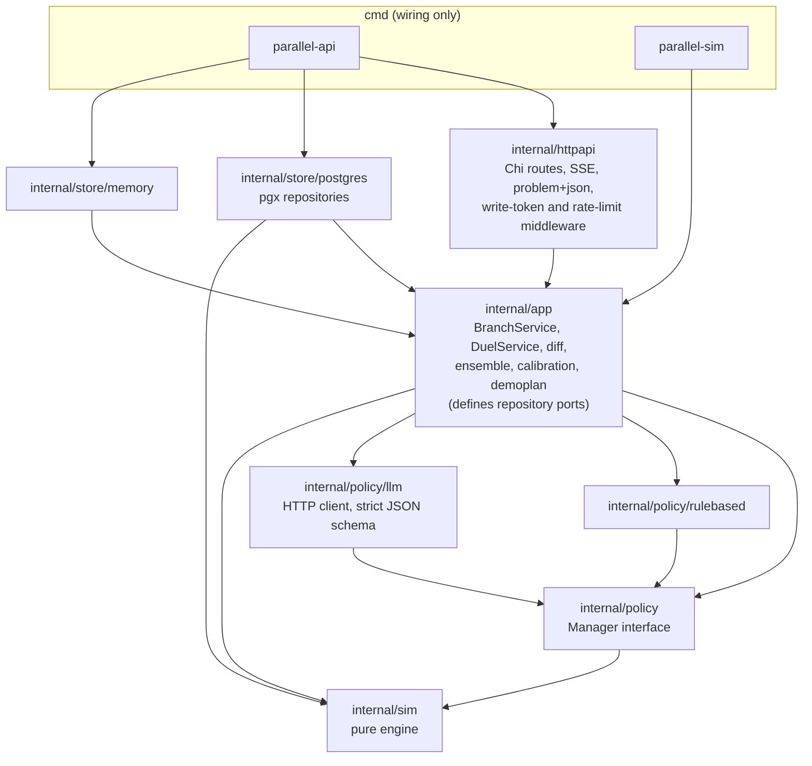
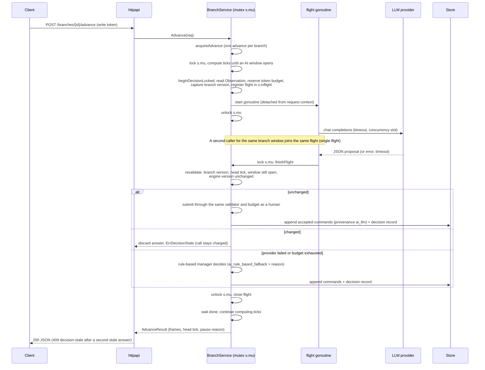
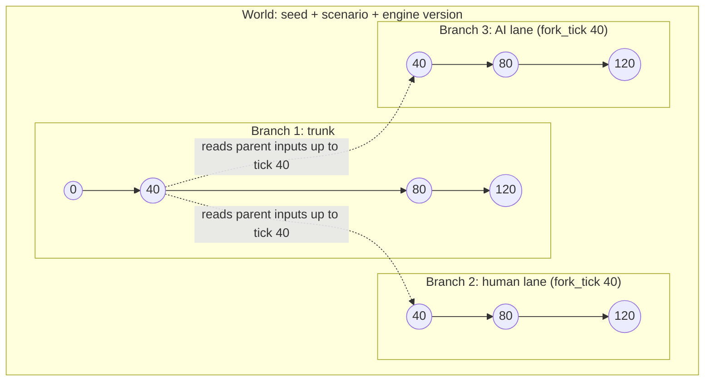
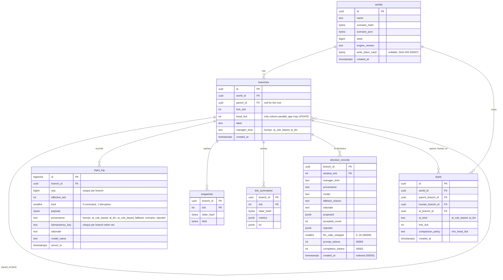
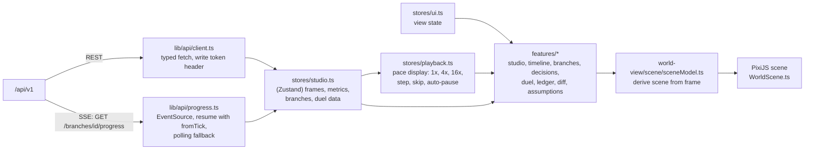

# Architecture

Technical companion to the [README](../README.md). Every statement here was checked against the code, the migrations (`backend/migrations/00001` to `00007`) or `backend/api/openapi.yaml`. The Mermaid diagrams render on GitHub.

> Synthetic simulation output under the stated assumptions. Not a forecast or guarantee of real-world results.

## 1. Module boundaries and dependency direction

One Go module, one binary for the API (`cmd/parallel-api`), one CLI (`cmd/parallel-sim`), one Next.js app. Dependencies point inward: nothing in `internal/sim` knows about the layers above it.

| Package | Role | Notable rule |
|---|---|---|
| `internal/sim` | Engine, event queue, SplitMix64 streams, ledger, metrics, score, validator, canonical encoding, state hash | Only allowlisted standard library imports; `internal/archtest` fails the build otherwise. No `time`, `math/rand`, `os`, `net`, `sync`, no goroutines, no floats in state transitions |
| `internal/policy` | `Manager` interface: an Observation in, proposed commands out | Proposals only. Never mutates state |
| `internal/policy/rulebased` | Deterministic reorder-point and capacity rules | Depends only on `sim` types (through `policy`) |
| `internal/policy/llm` | OpenAI-compatible chat completions client, request limits, strict JSON proposal schema | The only package here that does network I/O |
| `internal/app` | Use cases: worlds, branches, advance, fork, duel, diff, ensemble, calibration, demo plan; token budgets for the LLM | Defines the store ports it needs; holds the service lock |
| `internal/store/memory`, `internal/store/postgres` | Repository implementations behind the same ports (shared contract suite in `storetest`) | PostgreSQL uses parameterised queries and the runtime role `parallel_app` |
| `internal/httpapi` | Routes under `/api/v1`, SSE, RFC 9457 problem+json, write-token guard | Maps typed domain errors to problems |
| `internal/replayfile` | Reads and writes the fixed-input replay file used by `verify` and ensemble arms | |

## 2. The tick model

Time is an integer number of simulated minutes. Tick N covers minutes `[(N-1)*60, N*60)`. Events are ordered by `(At, Priority, Seq)`: the minute, a priority (lower runs first), and an insertion sequence number that breaks ties deterministically. Engine version 2.

Within one tick the recurring processes run at fixed offsets from the start of the tick:

| Offset (min) | Priority | Event |
|---|---|---|
| any | 0 | Command applied (runs before everything else at the same minute) |
| any | 1 | Disruption end |
| any | 2 | Disruption start |
| any | 3 | Purchase order receipt |
| 5 | 4 | Demand arrivals (generate potential customers, convert to orders) |
| 30 | 5 | Fulfilment (pick, pack, ship; revenue and cost of goods recognised) |
| 55 | 6 | Order cancellation |
| 58 | 7 | Accruals: labour, marketing, overhead (run in insertion order) |

Then the tick boundary: the engine hashes the state (SHA-256 over the canonical encoding) and builds the tick frame. Observations, snapshots, metrics and decision windows exist only at tick boundaries. A decision window opens at ticks that are multiples of the scenario's cadence (4 in the flagship) and at disruption onsets; the app layer adds a window at a fork tick. Commands submitted in the window at tick N take effect at tick N+1.

Random streams (`demand`, `disruption`, `supplier`, `workforce`) are SplitMix64 generators seeded with `seed XOR fnv64a(name)`. Their full internal state is part of the snapshot and the hash.

## 3. Request sequence: advancing a branch whose manager is an AI

A request that advances an AI-managed branch (or a duel) must wait for the AI's decision when a window opens. A slow LLM call must not block other requests, so the service releases its lock around the provider call.

Notes taken from `internal/app/ai_manager.go`:

- The rule-based manager decides immediately under the lock; only an external decider (the LLM) takes the flight path.
- A stale answer is discarded and the request is made once more; a second stale answer returns `ErrDecisionStale`, mapped to HTTP 409 with problem type `decision-stale`.
- Token and call reservations are taken before the provider request and settled with the provider-reported usage.
- If two processes decide the same window, the loser discards its commands and adopts the stored record (unique key `(branch_id, window_tick)`).
- A duel waits on the human window: `AdvanceDuel` refuses (`duel-window-open`) while the human's window at the head is open and not ended. The AI branch has already decided at its window by then, but the human cannot read the decision until the window is ended.

## 4. Event sourcing and forking

- **State is derived.** The truth is the world (scenario JSON, seed, engine version) plus the `input_log`. Replaying from tick 0 reproduces every tick's hash.
- **Fork.** A child branch row stores `parent_id` and `fork_tick`. Its effective input list is the parent's inputs with effective tick at or below the fork tick, followed by its own. The child's tick-N hash equals the parent's, and appending to either never changes the other's hashes (properties INV-4, INV-5).
- **Rewind** reads a past tick; no row is changed.
- **Snapshots** hold the complete state: event queue with its sequence counter, identifier counters and random stream states. They are loaded only when their stored hash matches the hash of the replayed state, so a bad cache is ignored, not trusted. `parallel_app` may insert and delete snapshots (a cache) but never update or delete input log rows.
- **Duels** record two branches forked from the same parent at the same tick, in lockstep.

## 5. Data model

From migrations 00001 to 00007. `input_log`, `decision_records` and `duels` reject UPDATE, DELETE and TRUNCATE through triggers (even for the table owner); `snapshots` and `tick_summaries` are caches.

Runtime role grants (00001, 00002, 00004): `parallel_app` has SELECT and INSERT on `worlds`, `branches`, `input_log`, `decision_records` and `duels`; `UPDATE (head_tick)` on `branches`; SELECT, INSERT and DELETE on `snapshots`; SELECT, INSERT, UPDATE and DELETE on `tick_summaries`; no DDL. The migrations run with the separate owner role `parallel_migrator`. Writes to a branch's input log take a transaction-scoped advisory lock (`pg_advisory_xact_lock`).

The ledger, metrics and orders are not tables: they are part of the derived engine state.

## 6. HTTP API

`backend/api/openapi.yaml` (OpenAPI 3.1) is the contract, and `web/lib/api/schema.d.ts` is generated from it (`npm run gen:api`; CI fails if it drifts). Errors are `application/problem+json`. Groups of routes under `/api/v1`: health and managers; worlds, demo and assumptions; branches (fork, advance, commands, decision-window end, disruptions, tick frames, state, metrics, ledger and ledger summary, journal, end of horizon, decisions, export, progress SSE); duels (create, advance, commands, window end, disruptions, score, decisions); and `POST /diffs`. `GET /healthz` and `GET /readyz` sit at the root.

Every mutating route requires the world's write token (`X-Parallel-Write-Token`), enforced by a route-table test. See [security-model.md](security-model.md).

## 7. Frontend architecture

- **Server truth, client view.** Zustand stores hold view state and fetched frames. Nothing in the web app computes a simulation result. The PixiJS scene is derived from the displayed tick frame (`sceneModel.ts`, `deriveSceneEvents.ts`); worker and van movement between two frames is decorative interpolation of positions (`interpolate.ts`) and never encodes a number that differs from the HUD.
- **Progress streaming.** `progress.ts` opens `GET /branches/{id}/progress` as server-sent events. Event ids are tick numbers. On error it reopens with `fromTick = lastTick + 1`, and after repeated failures, or without `EventSource`, it polls `GET /tick-frames`. The server sends a heartbeat every 15 s (`DefaultSSEHeartbeat`) and supports `Last-Event-ID`. Because ids are ticks shared by every branch of a world, an id identifies a tick, not a branch.
- **Batching.** The studio store flushes SSE frames into state at most every 50 ms (`FLUSH_MS` in `stores/studio.ts`); without it, per-frame updates hit React's nested update limit.
- **Playback is presentation.** `playback.ts` paces the display of frames the server already computed (Calm, Quick, Fast; 2, 8 and 32 ticks per second), with step, skip to next decision window or surprise, and automatic pause. It never changes a state hash.
- **Reduced motion.** `prefers-reduced-motion` disables interpolation, pulses and the fork sequence animation.
- **Routes** (`web/app`): `/` (intro), `/briefing`, `/setup`, `/worlds/[worldId]`, `/duels/[duelId]`.
- **Build-time API origin.** `NEXT_PUBLIC_API_BASE_URL` is inlined at build time and also drives the CSP `connect-src` (`web/next.config.ts`).
