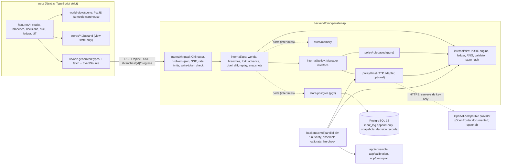
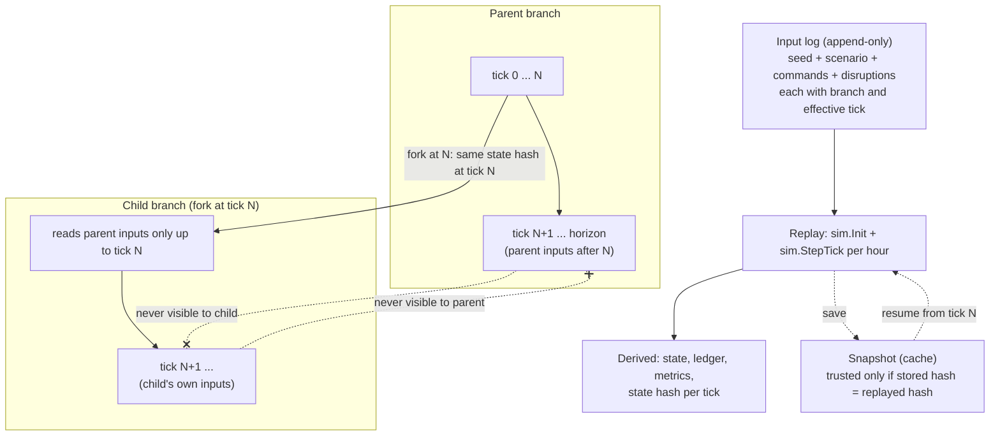

# Architecture diagrams (Mermaid)

Each statement was checked against the code at the time of writing; the file or symbol is named beside it. Mermaid text is the deliverable. No PNG or SVG was generated (see "Export").

## 1. System architecture



Checked against: dependency direction in `.kiro/steering/structure.md` and the imports enforced by `backend/internal/archtest` (`internal/sim` may import only an allowlist of standard-library packages). Routes in `backend/internal/httpapi/router.go` (`/branches/{branchId}/progress`, `/duels/...`, `/diffs`). Ports in `backend/internal/app/ports.go`. The CLI imports (checked in `backend/cmd/parallel-sim/*.go`): `internal/sim`, `sim/inputsfile`, `app/ensemble`, `app/calibration`, `app/demoplan`, `replayfile` and `policy/llm` (for `llm-check`).

## 2. Event sourcing and fork



Checked against: `backend/migrations/00001_init.sql` (trigger `input_log_immutable` raises on UPDATE and DELETE); `backend/internal/app/fork.go` (`ForkBranch`, `createChild`); `app/snapshots.go` (`saveSnapshot`, `loadSnapshot`); the invariant tests `fork_fidelity_prop_test.go` (child has the parent's tick-N hash), `fork_independence_prop_test.go`, `fork_prefix_prop_test.go`, `replay_prop_test.go`, and `sim/snapshot_resume_prop_test.go`. "Hash trusted only if equal to replayed" is stated in `simulation-invariants.md`. We did not re-read `loadSnapshot` line by line to confirm the verification step, so rely on the property tests and that steering text for this.

## 3. AI manager decision flow with the validator gate

```mermaid
sequenceDiagram
  autonumber
  participant Svc as app.BranchService
  participant Obs as sim.Observation
  participant Mgr as policy.Manager (rule-based or LLM)
  participant Val as sim.Validate (deterministic gate)
  participant Log as Input log
  participant Eng as sim.StepTick

  Svc->>Obs: build observation at decision window tick N
  Svc->>Mgr: Propose(ctx, obs, budget)
  alt Rule-based
    Mgr-->>Svc: Proposal(commands, rationale) (pure, no network)
  else LLM configured and within limits
    Note over Svc,Mgr: lock released for the provider call.<br/>Budget reserved first. 20 s timeout. Strict JSON.
    Mgr-->>Svc: Proposal or failure
    opt failure (timeout, http_error, invalid_json, schema_violation, budget_exhausted)
      Svc->>Mgr: fall back to rule-based, provenance ai_rule_based_fallback + reason
    end
    Svc->>Svc: revalidate branch version; stale answer is discarded (HTTP 409)
  end
  Svc->>Val: Validate(scenario, obs, commands, remaining budget)
  Val-->>Svc: accepted / rejected with reason codes
  Svc->>Log: append accepted commands, effective tick N+1, provenance
  Svc->>Eng: advance with inputs
  Eng-->>Svc: new state, outcomes, hash
```

Checked against: `backend/internal/policy/policy.go` (`Manager.Propose(ctx, obs, budget)` returns only a `Proposal`; "a Manager never mutates state"); `backend/internal/app/branch_service.go` (`SubmitCommands` runs `sim.Validate(c.sc, obs, req.Commands, remaining)`); `app/ai_manager.go` (`decider`, fallback to rule-based, `FallbackReason`), `app/ai_llm.go`; the five fallback reasons and the 20 s timeout in `.kiro/steering/security.md`; the lock-release, single-flight and `ErrDecisionStale` → HTTP 409 behaviour in `tasks.md` "M6 implementation notes"; "commands submitted at tick N take effect at tick N+1" in `simulation-invariants.md`. The same validator is used for human commands; the engine does not read manager kind or provenance (INV-18, `presentation_prop_test.go`). Not verified in code for this file: the exact order in which the budget reservation and the rule-based fallback happen inside `ai_llm.go`. The sequence follows the documented design.

## Export

Mermaid text renders directly on GitHub. To make images:

- Paste each block into https://mermaid.live and export PNG or SVG.
- Or, with Node installed and a Chromium available: `npx -y @mermaid-js/mermaid-cli -i diagram.mmd -o diagram.svg` (downloads puppeteer and Chromium; Playwright's Chromium can be reused through a puppeteer config).

Image export was **not** attempted in this pass, and `docs/hackathon/diagrams/` was not created. Mermaid text is sufficient for the repository.
